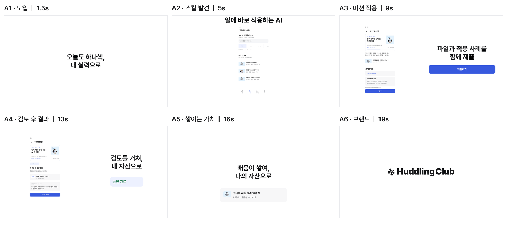

# Mission Approved — Codex

Codex에서 브랜드 기준을 지키며 영상을 제작하는 모션 하네스와, 그 하네스로 완성한 허들링 클럽 소개 영상입니다.

## 완성 영상

- [최종 MP4](out/huddling-intro-20s/final.mp4): **20초 · 1920×1080 · 30fps · 600프레임 · H.264 · 무음**.
- [장면표](out/huddling-intro-20s/scenes.md), [영상 검증 기록](out/huddling-intro-20s/video-report.md), [독립 검수 이력](out/huddling-intro-20s/review.md).
- 무음은 사용 가능한 음원 공급원이 없는 환경에서의 납품 방식입니다. 사용 권한이 있는 음원을 별도 트랙으로 추가할 수 있습니다.



## Codex에서 시작

1. 이 저장소의 루트 폴더를 Codex 프로젝트로 엽니다.
2. 외부 HyperFrames 스킬이 없다면 프로젝트 루트에서 설치합니다.

```sh
npx --yes skills add heygen-com/hyperframes --agent codex --yes
```

3. Codex에 **“모션 만들자”**라고 요청합니다. 루트 `AGENTS.md`가 제작 스킬과 역할 정의를 안내합니다.

Codex가 무엇을 만들지·몇 초인지·어떤 레퍼런스를 쓸지 묻습니다. 장면표 3안에서 하나를 고른 뒤 상세 장면표와 스냅보드를 각각 승인하면 제작을 진행합니다.
`CLAUDE.md`는 수업의 공통 규약 이름으로 보존했습니다. 이 저장소의 에이전트 실행 파일은 **Codex용 `.codex/agents/*.toml`**입니다.

## 편집·검사·다시 렌더하기

Node.js 22 이상과 FFmpeg가 필요합니다. 새로운 레퍼런스 영상을 받을 때는 yt-dlp도 사용할 수 있습니다.
아래 명령은 기존 완료 영상을 편집하는 경우입니다. 새 영상은 하네스로 별도의 `out/<영상이름>/`를 만듭니다.

```sh
cd out/huddling-intro-20s/video
npm run dev
```

미리보기에서 HTML 장면과 원본 에셋을 편집할 수 있습니다. CLI는 `package.json`의 HyperFrames 0.8.198로 고정돼 있습니다.

```sh
npm run check
npm run render -- --output ../final.mp4 --quality delivery --fps 30 --format mp4 --strict
```

기존 검증은 승인된 파일 버전에 대한 기록입니다. 소스·기준을 수정했다면 검사를 다시 수행하고 승인 상태를 갱신해야 합니다.
자동 motion 검사는 기존 실행에서 비활성이었으며, 실제 MP4 디코딩 표본·소스·타임라인을 독립 검수했습니다. 범위는 영상 검증 기록에 명시했습니다.

## 파일 구조

```text
AGENTS.md                     Codex 진입 지침
CLAUDE.md                     수업 공통 하네스 규약
.codex/agents/                art-director · director · builder · critic
skills/make-video/SKILL.md     제작 순서·승인·검수·재개 규약
skills-lock.json              외부 스킬 출처 기록
docs/                         design.md · motion.md · video.md
src/                          원본 화면·HTML 부품·폰트·로고
references/README.md          레퍼런스 출처와 관찰 기록
out/huddling-intro-20s/        BRIEF · 장면표 · 스냅보드 · 검수 · 최종 MP4
  video/                      편집 가능한 HyperFrames 프로젝트
  decoded-video-r1/            실제 MP4에서 추출한 검증 표본
```

외부 스킬 설치본, 원본 레퍼런스 영상·문서·캡처, 임시 캐시, 로컬 미리보기 상태와 실행 로그는 Git에 포함하지 않습니다.
`references/README.md`와 기준 문서의 URL에서 레퍼런스 출처를 확인할 수 있습니다. 원본 레퍼런스는 구현 영상의 에셋으로 쓰지 않았습니다.
완료 실행의 JSON·보고서는 당시의 로컬 검증 이력이며 일부 로컬 경로·로그 링크는 다른 환경에서 그대로 열리지 않을 수 있습니다.

## 출처

- 실습 시작 재료: [figmatutor-info/huddling-motion-start](https://github.com/figmatutor-info/huddling-motion-start). 원본 Git 이력을 유지합니다.
- 영상 프레임워크와 스킬: [heygen-com/hyperframes](https://github.com/heygen-com/hyperframes).
- 원본 폰트·로고·캐릭터는 `docs/design.md`와 `src/`의 출처를 따릅니다. 포함된 GSAP 파일의 라이선스 표시는 보존했습니다.
